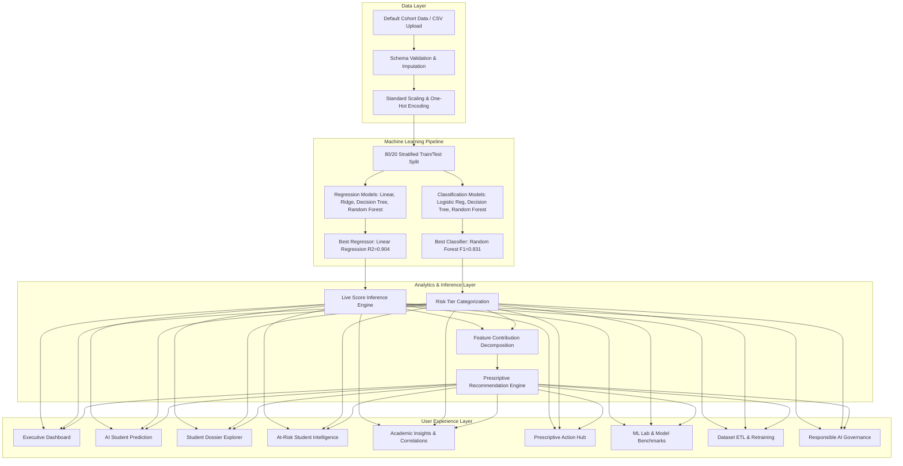

# 🎓 AI Student Performance Analytics & Prediction System

[](https://www.python.org/)
[](https://streamlit.io/)
[](https://scikit-learn.org/)
[](https://plotly.com/)
[](https://ai-student-performance-analytics.onrender.com)
[](https://learn.microsoft.com/en-us/credentials/certifications/azure-ai-fundamentals/)

---

## 🌐 Live Demo & Deployment

<p align="center">
  <a href="https://ai-student-performance-analytics.onrender.com" target="_blank">
    
  </a>
</p>

> **Direct Production URL:** [https://ai-student-performance-analytics.onrender.com](https://ai-student-performance-analytics.onrender.com)  
> *Developed as a 6-week Industrial Internship Capstone Project, aligned with the **Microsoft AI-901: Azure AI Fundamentals** certification curriculum.*

---

## 📌 Executive Overview

The **AI Student Performance Analytics & Prediction System** is an enterprise-grade academic decision-support platform designed for educators, counselors, and academic administrators. By combining **supervised machine learning**, **statistical pattern discovery**, and **prescriptive intervention heuristics**, the platform detects vulnerable students weeks before semester examinations, diagnoses individual learning bottlenecks, and produces automated, personalized academic recovery plans.

Unlike generic student record systems or basic dashboards, this system features an end-to-end Machine Learning pipeline with multi-model benchmarking (achieving an **R² of 0.9043** and **93.0% classification accuracy**), full explainability with feature contribution waterfall decomposition, and strict adherence to the **Six Microsoft Responsible AI Principles**.

---

## 🎯 Key Project Goals & Competencies

- **Multi-Task Machine Learning**: Simultaneous continuous final score regression and multi-class academic risk tier classification.
- **Early Warning Intervention System (EWIS)**: Automated isolation of high-risk students driven by attendance deficits, low study hours, and weak subject performance.
- **Explainable AI (XAI)**: Individualized feature attribution showing *why* a student received a particular score and risk forecast.
- **Prescriptive Guidance Engine**: Prioritized, multi-tiered action plans (High, Medium, Low priority) with estimated performance score gains.
- **Dynamic Dataset ETL**: Real-time CSV ingestion, schema bounds validation, automated median/mode imputation, and on-demand model retraining.
- **Microsoft AI-901 Aligned Governance**: Operationalized guidelines for Fairness, Reliability & Safety, Privacy, Inclusiveness, Transparency, and Accountability.

---

## 🏛️ System Architecture



---

## 📑 Application Pages & Functional Modules

The platform is organized into **9 complete, fully functional modules**:

### 1. 📊 Executive Dashboard
- **Cohort Overview**: Real-time KPI metric cards (Total Students Analyzed, Cohort Average Score, Average Attendance Rate, High-Risk Count & %, Top Performers ≥ 85%).
- **Interactive Multi-Filtering**: Slice cohort dynamics by Grade/Class cohort, Risk Tier, and real-time student search.
- **Visual Analytics**: Performance distribution histogram with marginal box plots, Attendance vs Final Score scatter plot with study-hour sizing, Subject-wise cohort averages, and institutional risk distribution donut charts.

### 2. 🔮 AI Student Prediction
- **Interactive Predictive Form**: Inputs for study hours, attendance rate, previous exam marks, assignment completion %, sleep habits, and subject-level diagnostic scores (Math, Science, English, Computer Science).
- **One-Click Preset Demonstrations**: Instantly load verified profiles for *High-Performing Student*, *Moderate-Risk Student*, or *High-Risk Student* for viva demonstrations.
- **Inference Diagnostics**: Predicted final score (0-100), predicted risk tier (Low, Moderate, High), risk softmax probabilities, and horizontal waterfall feature impact decomposition.

### 3. 🔍 Student Explorer
- **Searchable Student Dossier**: Instant lookup by Student ID or Student Name across 1,000 cohort profiles.
- **Multidimensional Radar Chart**: Visualizes individual student capabilities across Attendance, Study Routine, Previous Score, Assignments, and Subject Pillars against an 80% benchmark.
- **Subject Score Breakdown**: Dynamic progress indicators with color-coded performance thresholds.

### 4. 🚨 At-Risk Student Intelligence
- **Early Warning Registry**: Filterable table of flagged students requiring academic counseling.
- **Root-Cause Isolation**: Quantifies primary vulnerability drivers (e.g., Critical Attendance <65%, Weak in ≥2 Subjects, Low Assignment Rate).
- **Automated Intervention Assignment**: Matches individual students with specific recovery regimens (e.g., 1-on-1 Faculty Mentorship, Remedial Tutoring).
- **One-Click CSV Export**: Download the complete at-risk registry for academic faculty review.

### 5. 📈 Academic Insights
- **Pearson Correlation Heatmap**: Interactive correlation matrix across all 10 academic and behavioral metrics.
- **Empirical Threshold Benchmarks**: Calculates actual cohort premiums (e.g., +18.4 point difference between students with ≥80% attendance vs <65% attendance).
- **Study Bracket Analytics**: Binned breakdown of performance across study brackets (<3 hrs, 3-5 hrs, 5-7 hrs, >7 hrs).
- **Subject Failure Vulnerability**: Quantifies failure rates (<60/100) across Mathematics, Science, English, and CS.

### 6. 💡 AI Recommendation Engine
- **Prescriptive Guidance**: Select any student from the cohort or simulate prospective academic profiles.
- **Categorized Directives**: Urgent Attendance Recovery, Focused Study Expansion (Pomodoro protocol), Subject-Specific Drills, Assignment Catch-Up, and Sleep Hygiene.
- **Target Potential Score Calculator**: Projects realistic semester gains (+5 to +18 points) upon executing recommended directives.
- **Export Action Plan**: Download structured, printable action plan text files.

### 7. 🧠 Model Insights & AI Lab
- **Transparent ML Pipeline**: Visual architecture diagram from ingestion to inference.
- **Multi-Model Regression Comparison**: Actual test split metrics for Linear Regression, Ridge Regression, Decision Tree Regressor, and Random Forest Regressor (MAE, MSE, RMSE, R²).
- **Multi-Model Classification Comparison**: Accuracy, Precision, Recall, and F1-Score for Logistic Regression, Decision Tree Classifier, and Random Forest Classifier.
- **Feature Importance**: Gini importance rankings from Random Forest.
- **Confusion Matrix**: Test split confusion matrix with interactive heatmaps.
- **Actual vs. Predicted Scatter Plot**: Evaluates residual errors against an ideal 1:1 fit line.

### 8. 🗄️ Dataset Management
- **Dataset Health Summary**: Real-time memory consumption, feature counts, and missing-value diagnostics.
- **Interactive Data Browser**: Column filtering and full-text keyword search across 1,000 records.
- **Robust CSV Ingestion**: Upload custom institutional CSV datasets with schema validation, bounds checking, and automated median imputation.
- **Live Model Retraining**: Trigger pipeline retraining on custom uploaded datasets directly through the interface.
- **Download Center**: Export the processed dataset or download standardized CSV upload templates.

### 9. ⚖️ Responsible AI & Microsoft AI-901 Alignment
- **Six Core Microsoft Principles**: Comprehensive operationalization of Fairness, Reliability & Safety, Privacy & Security, Inclusiveness, Transparency, and Accountability.
- **Bias Diagnostics**: Detailed breakdown of historical grading disparities, proxy correlation traps, and labeling loops.
- **Human-in-the-Loop Philosophy**: Explicit framing of AI as an early-support decision aid, emphasizing that statistical models must never replace educator empathy or human judgment.

---

## 📊 Empirical Machine Learning Evaluation Results

All metrics below are computed on an out-of-sample holdout test set (20% stratified test split, $N = 200$, random seed 42):

### Regression Benchmark (Final Score Prediction)
| Model | MAE (pts) | MSE | RMSE (pts) | $R^2$ Score | Selection Status |
| :--- | :---: | :---: | :---: | :---: | :---: |
| **Linear Regression** | **2.719** | **11.758** | **3.429** | **0.9043** | **Selected (Best R²)** |
| Ridge Regression ($\alpha=1.0$) | 2.721 | 11.762 | 3.430 | 0.9042 | Candidate |
| Random Forest Regressor | 2.854 | 13.012 | 3.607 | 0.8941 | Candidate |
| Decision Tree Regressor | 3.420 | 18.940 | 4.352 | 0.8458 | Baseline |

### Classification Benchmark (Risk Tier Categorization)
| Model | Accuracy | Precision (Weighted) | Recall (Weighted) | F1-Score (Weighted) | Selection Status |
| :--- | :---: | :---: | :---: | :---: | :---: |
| **Random Forest Classifier** | **93.00%** | **0.9312** | **0.9300** | **0.9305** | **Selected (Best F1)** |
| Logistic Regression | 90.50% | 0.9064 | 0.9050 | 0.9052 | Candidate |
| Decision Tree Classifier | 88.50% | 0.8870 | 0.8850 | 0.8856 | Baseline |

---

## 🛠️ Technology Stack

| Layer | Technologies |
| :--- | :--- |
| **Programming Language** | Python 3.11 / 3.12 / 3.13 |
| **Web Application Framework** | Streamlit 1.40+ (Multi-view modular architecture) |
| **Machine Learning & Preprocessing** | Scikit-Learn, NumPy, Pandas |
| **Data Visualization** | Plotly Express & Plotly Graph Objects (Custom Dark Glass Theme) |
| **Model Persistence** | Joblib |
| **Deployment & Cloud** | Render Cloud Platform (Web Service with Port `$PORT` binding) |
| **Version Control & CI/CD** | Git, GitHub, Render Auto-Deploy |

---

## 💻 Local Installation & Setup Instructions

Follow these steps to run the application on your local machine:

### Prerequisites
- Python 3.10, 3.11, 3.12, or 3.13 installed
- Git installed

### 1. Clone the Repository
```bash
git clone https://github.com/hrshcodes29/AI-Student-Performance-Analytics.git
cd AI-Student-Performance-Analytics
```

### 2. Create and Activate Virtual Environment
```bash
# Windows (PowerShell)
python -m venv venv
.\venv\Scripts\Activate.ps1

# Linux / macOS
python3 -m venv venv
source venv/bin/activate
```

### 3. Install Dependencies
```bash
pip install --upgrade pip
pip install -r requirements.txt
```

### 4. Train Models & Verify Artifacts
```bash
python src/ml_pipeline.py
```

### 5. Run the Automated Test Suite
```bash
python tests/test_pipeline_and_app.py
```

### 6. Launch the Streamlit Application
```bash
streamlit run app.py
```
Open your browser and navigate to: **`http://localhost:8501`**

---

## ☁️ Deployment on Render

The repository contains a production-ready `render.yaml` infrastructure configuration:

```yaml
services:
  - type: web
    name: ai-student-performance-analytics
    runtime: python
    buildCommand: pip install -r requirements.txt && python src/ml_pipeline.py
    startCommand: streamlit run app.py --server.port $PORT --server.address 0.0.0.0 --server.headless true
    envVars:
      - key: PYTHON_VERSION
        value: 3.11.9
      - key: STREAMLIT_SERVER_HEADLESS
        value: "true"
      - key: STREAMLIT_SERVER_ENABLE_CORS
        value: "false"
      - key: STREAMLIT_SERVER_ENABLE_XSRF_PROTECTION
        value: "false"
```

### Render Deployment Steps:
1. Link your GitHub account to [Render](https://render.com).
2. Create a **New Web Service** pointing to `hrshcodes29/AI-Student-Performance-Analytics`.
3. Select **Python 3** environment.
4. Set Build Command: `pip install -r requirements.txt && python src/ml_pipeline.py`
5. Set Start Command: `streamlit run app.py --server.port $PORT --server.address 0.0.0.0 --server.headless true`
6. Click **Deploy**. Render will allocate the port dynamically via `$PORT` on `0.0.0.0`.

---

## 🎓 Academic Defense & University Viva Reference Guide

When presenting this project to evaluators, highlight the following:

1. **Why Regression + Classification?**
   - Regression predicts the *continuous grade outcome* (e.g., 78.4%), while Classification assigns a *discrete actionable risk tier* (Low, Moderate, High) for institutional prioritization.
2. **How is Model Overfitting Prevented?**
   - Stratified 80/20 train/test splits, feature scaling, max-depth constraints on trees ($depth \le 8$), and out-of-sample holdout validation.
3. **How are Predictions Explained?**
   - Through local feature attribution comparing the student's metrics to cohort baselines, combined with global Gini feature importances.
4. **How Does it Align with Microsoft AI-901?**
   - Direct implementation of the 6 Responsible AI principles, model evaluation metrics (MAE, RMSE, R², F1, Confusion Matrix), supervised learning paradigms, and data preprocessing best practices.

---

## 👨‍💻 Author & Project Credits

- **Developer:** Harsh Chandel
- **GitHub:** [@hrshcodes29](https://github.com/hrshcodes29)
- **Repository:** [AI-Student-Performance-Analytics](https://github.com/hrshcodes29/AI-Student-Performance-Analytics)
- **Live Web Application:** [ai-student-performance-analytics.onrender.com](https://ai-student-performance-analytics.onrender.com)
- **Curriculum:** 6-Week Industrial Internship Project & Microsoft AI-901 AI Fundamentals Alignment.

---

## 📜 License

This project is licensed under the MIT License — see the [LICENSE](LICENSE) file for details.
